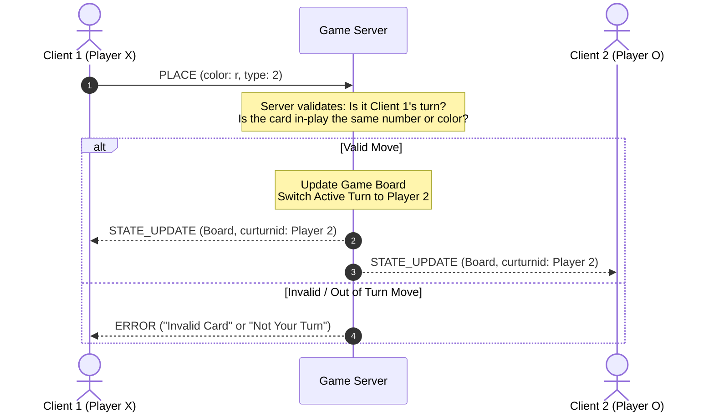

# Concurrency Design
### 2.1 Server Concurrency Model Selection
Option A: Multi-Threading (threading.Thread / socketserver.Thream dingTCPServer)
A dedicated worker thread is spawned for each connected client connection socket.
Shared memory structures (game state, board grid, client socket list) are protected using threading.Lock to prevent race conditions during state mutation.

### 2.2 Client State & Turn Synchronization Scheme

### 2.3 Score & Leaderboard Synchronization Design
##### Round Scores in Server Memory
The server stores a tuple corresponding to each player which acts as the authoritative source of truth for the game state. This tuple contains their player number and all the cards currently in their hand. Each player number has it's own write mutex, meaning that only one request can be executed on a certain player's hand at a time, like a +4 card being played, or a player drawing another card into their own hand. 
##### Broadcast Logic Upon Round Completion
Upon round completion, an STATE_UPDATE message is sent to all players with the number of the player who's turn it currently is, the card in-play, how many cards each player has in their hand, and the player's own hand. This information is then relayed through printed statements to the player with headers for each of the aforementioned values.
